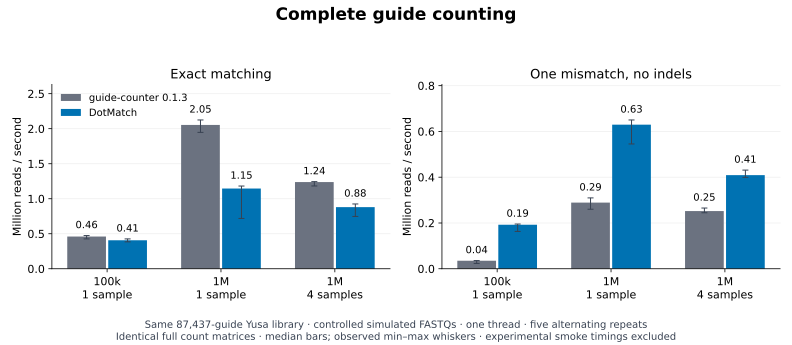
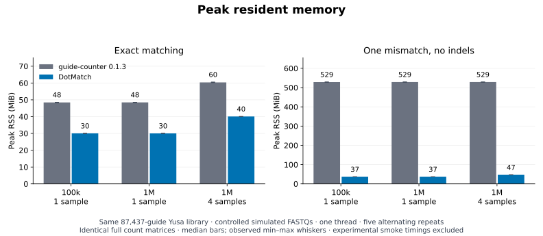

# DotMatch

**Known-target DNA read assignment and QC from FASTQ.**

DotMatch compares a fixed window from each FASTQ read against a table of expected short DNA sequences: CRISPR guides, inline barcodes, feature tags, primers, or panel targets. It runs locally on Linux and macOS and writes MAGeCK-compatible count tables, split FASTQs, and assignment QC without hiding ambiguous reads.

DotMatch is the guide-counting engine for **CRISPRWorks Count**; see the [CRISPRWorks family overview](https://dotmatch.readthedocs.io/en/latest/crisprworks.html) for experimental gene-effect inference tools.

[](https://github.com/dnncha/dotmatch/actions/workflows/ci.yml)
[](https://pypi.org/project/dotmatch/)
[](https://dotmatch.readthedocs.io/en/latest/)
[](https://doi.org/10.5281/zenodo.20541628)

[Count CRISPR guides](https://dnncha.github.io/dotmatch/crispr-guide-counting/) ·
[Check a library in your browser](https://dnncha.github.io/dotmatch/tools/library-safety/) ·
[Documentation](https://dotmatch.readthedocs.io/en/latest/) ·
[Benchmarks and methods](https://dotmatch.readthedocs.io/en/latest/benchmarks/crispr_comparison/README.html)

## Install and verify

Release 0.8.0 is published on PyPI (GHCR has 0.7.0) and includes the six `dotmatch agent` tools and the local `dotmatch mcp` server:

```bash
python3 -m pip install dotmatch==0.8.0
dotmatch --version
```

Run the packaged offline fixture to verify native counts without study data or network access:

```bash
dotmatch demo --out-dir first-run/
```

Open `first-run/index.html` to inspect the local review bundle. To compare existing raw count tables by guide and sample ID, use [`dotmatch compare-counts`](https://dotmatch.readthedocs.io/en/latest/count-comparison.html).

Conda and container routes:

```bash
conda create -n dotmatch -c conda-forge -c bioconda dotmatch
conda activate dotmatch

# Or use the pinned release container:
docker run --rm ghcr.io/dnncha/dotmatch:v0.7.0 --version
```

Bioconda and its generated BioContainers images can lag PyPI and GHCR. When a newly tagged version has not reached Bioconda yet, install from PyPI or build from source, and verify `dotmatch --version`. The Bioconda recipe includes `osx-arm64` for Apple Silicon. See [packaging details](https://dotmatch.readthedocs.io/en/latest/packaging.html) for platform verification and the [installation guide](https://dotmatch.readthedocs.io/en/latest/getting-started.html) for source builds and the third-party Homebrew tap. The optional desktop Workbench is developed separately in `dotmatch-community`.

## How DotMatch classifies reads

An overall mapped-read percentage cannot show which guides gained counts, which reads fit multiple targets, or how mismatch tolerance shifted assignments. DotMatch records one explicit outcome for every read:

| Outcome | Meaning | Added to target counts? |
| --- | --- | --- |
| `unique` | Exactly one target fits the configured distance rule | Yes |
| `ambiguous` | Two or more targets fit | No |
| `none` | No target fits within the distance threshold | No |
| `invalid` | The configured read window cannot be extracted | No |

Only `unique` calls add to target counts by default. Choose the matching policy deliberately: a unique call shows compatibility under the chosen rules rather than proof of biological origin.

Keep downstream statistics in your existing pipeline. DotMatch is not a genome aligner, basecaller, cell or UMI quantifier, or gene-level hit-calling package.

## Count a CRISPR screen

Prepare a guide CSV or TSV with target sequences alongside your FASTQ files. Keep biological sample names distinct from sequencing filenames; see the [first-run tutorial](https://dotmatch.readthedocs.io/en/latest/tutorials/crispr-count-first-run.html) for column formats and a worked example.

Initialize a draft assay project:

```bash
dotmatch crispr quickstart \
  --library guides.csv \
  --fastq 'fastqs/*.fastq.gz' \
  --out crispr_screen/
```

Review `crispr_screen/inference_report.json` and `assay.toml` to confirm the guide window, orientation, library, and sample files. Change `status = "draft"` to `status = "ready"` in `assay.toml`, then run the count and generate a portable review handoff:

```bash
dotmatch assay start crispr_screen/assay.toml

# Package config, QC, methods, and checksums without raw FASTQs:
dotmatch assay handoff crispr_screen/assay.toml
```

Use [`dotmatch crispr-count`](https://dotmatch.readthedocs.io/en/latest/tutorials/crispr-count-first-run.html) when you want a single direct command that writes a MAGeCK-compatible count table, or `dotmatch guide-counter count` when matching existing `guide-counter` scripts.

## Compare matching policies

Different mismatch policies can produce the same total assigned reads while shifting counts between individual guides. `dotmatch sensitivity` evaluates exact, radius-one, and best-distance Hamming assignment across identical read windows in one FASTQ pass. It writes three count matrices, per-guide deltas, read-state transitions, checksums, and a static HTML report without choosing a policy for you.

Run the bundled synthetic fixture from a v0.8.0 source checkout:

```bash
python3 -m pip install dotmatch==0.8.0
dotmatch sensitivity \
  --targets examples/assignment_sensitivity/targets.tsv \
  --reads examples/assignment_sensitivity/reads.fastq \
  --target-start 0 --target-length 20 \
  --write-read-changes --out-dir sensitivity-example
```

Or open the [interactive sensitivity viewer](https://dnncha.github.io/dotmatch/assignment-sensitivity/) in your browser with the [nine-read synthetic fixture](https://github.com/dnncha/dotmatch/tree/main/examples/assignment_sensitivity). Both demonstrate software behavior and sensitivity analysis; neither measures biological accuracy. See the [sensitivity output contract](https://dotmatch.readthedocs.io/en/latest/sensitivity.html) for schema details.

## Choose by task

| Task | Entry point | Workflow |
| --- | --- | --- |
| CRISPR guide counting | `dotmatch crispr-count` | [First run](https://dotmatch.readthedocs.io/en/latest/tutorials/crispr-count-first-run.html) |
| Inline barcode demultiplexing | `dotmatch demux` | [Getting started](https://dotmatch.readthedocs.io/en/latest/getting-started.html) |
| High unmatched or ambiguous barcode rate | `dotmatch barcode autopsy` | [Barcode diagnostics](https://dotmatch.readthedocs.io/en/latest/getting-started.html#diagnose-a-barcode-run) |
| Target-library collisions | `dotmatch audit` | [Browser checker](https://dnncha.github.io/dotmatch/tools/library-safety/) |
| Barcode panel design | `dotmatch panel design` | [Panel documentation](https://dotmatch.readthedocs.io/en/latest/barcode-panel-design.html) |
| Paired target counting | `dotmatch pair-count` | [Command reference](https://dotmatch.readthedocs.io/en/latest/command-reference.html) |
| Cell-by-feature matrix from extracted observations | `dotmatch feature matrix` | [scverse handoff](https://dotmatch.readthedocs.io/en/latest/tutorials/scverse-perturb-seq.html) |

Feature matrices require upstream cell identifiers and extracted feature windows. They do not call cells, deduplicate UMIs, or estimate perturbation effects.

## Benchmarks and reproducibility

> **Benchmark spotlight: faster one-mismatch counting with identical counts**
>
> In paired benchmarks from the source checkout, `dotmatch guide-counter count` ran **1.6–5.5× faster with 11.3–14.4× lower peak memory** than unmodified `guide-counter` 0.1.3 on tested one-mismatch workflows, producing zero differences in the full guide-by-sample count matrices.
>
> Measurements used controlled 100k-read and 1M-read FASTQs against the 87,437-guide Yusa library on one CPU thread across five paired repeats. `guide-counter` was faster in the tested exact-mode 1M-read cases, and full experimental-screen performance and biological accuracy require separate validation.
> [Read the guide-counter comparison, protocol, and raw results](https://dotmatch.readthedocs.io/en/latest/benchmarks/guide_counter/README.html).





Additional checked reports and examples:

- [Benchmark reports](https://dotmatch.readthedocs.io/en/latest/benchmarks/README.html): recorded commands, hardware, and assignment rules for every benchmarked workload.
- [Hamming k=3 engine comparison](https://dotmatch.readthedocs.io/en/latest/benchmarks/hamming_seed_layout/README.html): 5.2–5.7× faster complete `k=3` counting than the prior engine on 30,000 simulated reads and the Yusa library with identical counts, plus 136,096 oracle checks.
- [Public CRISPR comparisons](https://dotmatch.readthedocs.io/en/latest/benchmarks/crispr_comparison/README.html): Yusa and Brunello runs comparing exact, Hamming, and Levenshtein semantics separately.
- [GSE146194 direct-guide-capture case study](https://github.com/dnncha/dotmatch/tree/main/examples/perturb_seq_gse146194): per-read assignment checked against independent reference implementations across discovery and evaluation reads (does not establish guide-per-cell or perturbation-effect accuracy).
- [Bunsen](https://bunsen.science/): published bioinformatics investigations, reproducible examples, and follow-up corrections.

Try an installation-free synthetic smoke demo on [Binder](https://mybinder.org/v2/gh/dnncha/dotmatch/main?labpath=demo.ipynb) or [Google Colab](https://colab.research.google.com/github/dnncha/dotmatch/blob/main/demo.ipynb), or share a de-identified discrepancy fixture in the [public validation thread](https://github.com/dnncha/dotmatch/issues/82) (never post private reads or unpublished guide libraries).

## Python, pipelines, and AI agents

DotMatch includes a [Python streaming API](https://dotmatch.readthedocs.io/en/latest/streaming-api.html), [public output schemas](https://dotmatch.readthedocs.io/en/latest/schemas.html), and [workflow examples](https://github.com/dnncha/dotmatch/tree/main/examples/workflows). The [ecosystem status ledger](https://dotmatch.readthedocs.io/en/latest/ecosystem-status.html) separates local examples from accepted upstream integrations. Development typing and test commands live in [docs/typing-and-testing.md](https://github.com/dnncha/dotmatch/blob/main/docs/typing-and-testing.md), and the assignment reliability contract lives in [docs/scientific-reliability.md](https://github.com/dnncha/dotmatch/blob/main/docs/scientific-reliability.md).

### Use DotMatch from an AI agent

Connect DotMatch as a local stdio MCP server in Claude Code, Codex, Cursor, or another MCP client:

```bash
claude mcp add dotmatch -- uvx dotmatch mcp
codex mcp add dotmatch -- uvx dotmatch mcp
```

In Claude Code, you can also install the plugin bundling the MCP server and routing skill:

```text
/plugin install dotmatch --marketplace dnncha/dotmatch
```

On older Claude Code versions, run `/plugin marketplace add dnncha/dotmatch` and then `/plugin install dotmatch@dotmatch`. Generic MCP clients can run `{"mcpServers": {"dotmatch": {"command": "uvx", "args": ["--from", "git+https://github.com/dnncha/dotmatch", "dotmatch", "mcp"]}}}`, or call `dotmatch mcp` directly when installed locally.

The MCP server exposes `route_task`, `count_targets`, `demux_barcodes`, `audit_targets`, and `edit_distance` alongside the six local assay workflow tools (`discover`, `prepare_assay`, `inspect_assay`, `run_assay`, `review_assay`, `handoff_assay`). Every tool runs locally, accepts structured JSON arguments only, refuses to overwrite existing output directories, and returns structured envelopes.

From the CLI, inspect machine-readable task routing and tool contracts with:

```bash
dotmatch capabilities --json
dotmatch agent tools --json
dotmatch agent export-skill --target ./dotmatch-agent
```

See the [Agent guide](https://dotmatch.readthedocs.io/en/latest/agent-guide.html), [CRISPR agent route](https://dotmatch.readthedocs.io/en/latest/agent-crispr.html), [Perturb-seq agent route](https://dotmatch.readthedocs.io/en/latest/agent-perturb-seq.html), [agent-capabilities.json](https://dnncha.github.io/dotmatch/agent-capabilities.json), [agent-tools.json](https://dnncha.github.io/dotmatch/agent-tools.json), and the [checked contract fixture](https://dnncha.github.io/dotmatch/agent-reference-crispr.json).

## The CRISPRWorks family

| Component | Purpose | Availability |
| --- | --- | --- |
| **Count** | Count guides and inspect read assignments | Available through DotMatch |
| **Fit** | Fit gene effects, share guide efficacy across screens, and calibrate control-gene tails | [Experimental alpha from source](https://github.com/dnncha/dotmatch/tree/main/packages/crisprworks-fit) |
| **Review** | Inspect QC, comparisons, and screen results | DotMatch writes count and QC reports today; a broader Review tool is planned |

Read the [CRISPRWorks overview](https://dotmatch.readthedocs.io/en/latest/crisprworks.html) for status and scope, or [From counts to gene effects](https://dotmatch.readthedocs.io/en/latest/tutorials/crispr-fit-first-run.html) to try Fit from source.

## Citation and contributing

DotMatch is licensed under [Apache-2.0](https://github.com/dnncha/dotmatch/blob/main/LICENSE). Run `dotmatch citation` or see [CITATION.cff](https://github.com/dnncha/dotmatch/blob/main/CITATION.cff) and the [methods and citation guide](https://dotmatch.readthedocs.io/en/latest/methods-and-citation.html) to cite the exact release and assignment policy used. Bug reports, discrepancy fixtures, and pull requests are welcome; see [CONTRIBUTING.md](https://github.com/dnncha/dotmatch/blob/main/CONTRIBUTING.md).
